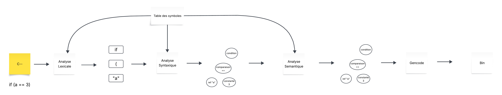

Comment marche un compilateur ?

1) Analyse lexicale 
Le compilateur Il prend en entrée un code source puis fait une analyse lexicale et sort des tokens.
Les espaces + retours à la ligne ont disparu.

code        -> analyse lexicale -> liste etoken
if (a==3)   ->                  -> token [if] - token [(] - valeur [a]

Pour représenter un token : 
structure Token {
   int type;
   int valeur;
   string ident;
   int ligne;
}

Avec un enum : 
enum {tok _ if, tok _ plus, tok _ const, tok _ ident}

2) Analyse syntaxique -> arbre en sortie
Prend en compte la syntaxe du langage (s'oppose à la sémantique)

               conditionel
                /    |    \
         comparaison
             ==
         /        \
      ref "a"     constante 3

3) Analyse sémantique -> arbre en sortie avec des annotations
Vérifie si l'arbre produit du code sémantiquement correcte. Puis relie les déclarations des variables.
Ex : on utilise une variable, mais est-ce qu'elle est déclarée ?

                  conditionel
                  /    |    \
            comparaison
               ==
            /        \
   ->  ref "a"     constante 3
      
4) Gencode : génération de code et transformation en binaire 

Table des symboles  : passe des informations entre les différentes étapes

EOS : token particulier qui est renvoyé à l'infi. Il simplifie l'analyseur syntaxique
2 tokens particuliers aussi : const, ident

Et tout ce qui va nous servir à écrire notre programme : 
Opérations : +,-,,*/,%
Comparaisons : > , <=, >=, ==, !
Booléens : &&, ||, !
Autre : (),[],{}
Fin de ligne : ;
Séparer : La virgule ','
Affectations : = 

Pointeurs : 2 choses !
récupéprer la valeur d'une variable : &
Indirection : *

Mots clés : 
if, else, for, while, do

Déclarer les variables : on a un seul type, les entiers, donc INT.
Déclarer les fonctions : void
Retourner une valeur : return
Boucles : continue, break

On va créer des fonctions. Quelle est l'interface que l'analyseur lexical fourni à l'analyseur syntaxique ?

Dans l'analyseur lexical on a : 

- Variable globale last : token juste avant le token courant
- Variable globale de type Token courant : qui dit quel est le token courant

- void init(code) : On lui donne le code.Libre de comment donner le code source au programme.
  On mets le code dans un variable global et appelle une fois next. 
/!\ important de faire des test.

- void next() : lit le prochain token dans le fichier et le mets dans la variable courant. Fonction next sans paramètres et ne renvoie rien. 

void next() {
   last = courant  //avance dans le flux de token, et remplit courant avec le prochain token
   //comment faire le reste du code
   -> on fait sauter les espaces qu'il y'a dans le texte/code pour trouver le début du prochain token
   -> ex : si on voit le début d'un commentaire, on le saute (rajouter + tard)

   sauter les espaces()
   c = prochain charactère
   switch(c):
   case '+' : courant.type = tok_plus
}
-> on a une lettre, un chiffre ou un charactères invalide

if (chiffre(c)){
   tok_const
}

if (lettre(c)){
   id = lireid(id) //tant qu'il y'a des lettres, on les récupère une par une comme chaine de caractère
   if (id == "if)....
} -> ou sinon on lest mets dans un tableau et on boucle dessus.

- int check(int type){
  if (courant.type == type){
      next();
      return true;
   }
   return false (message d'erreur qui arrête le compilateur);
  }

- void accept(int type) : fait la même chose que check, mais envoie un messagd d'erreur. ON l'utilise si à cet endroit on doit absolument avoir un token en particulier.
Exemple : si on a un if, on doit absolument avoir après un token parenthèse ouvrante. Dans ce cas on affiche un message d'erreur, et on arrête la compilation.

Dans l'analyseur syntaxique on a: 

mettre un préfix indiqunant que le type est token.(pour les enum)
